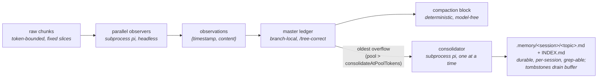

# observational-memory

Original system created by @amosblomqvist (Eero Alvar)

Tiered, subprocess-backed memory for pi.

Parallel **observers** distill raw conversation chunks into atomic observations committed to the master's branch-local **ledger** (so memory stays correct under `/tree`); a deterministic, model-free **compaction** renders that buffer verbatim into the compaction block. A **consolidator** promotes the oldest observations into durable `.memory/<sessionId>/` topic files, bounding the buffer and giving each session its own durable, `grep`-able long-term memory (a fork seeds its memory from its parent).

## On/off gate (default OFF)

The extension ships in the global extensions folder during development, so it is **gated off
per session** and is completely invisible until you turn it on.

- `/om` — toggle for this session
- `/om on` / `/om off` — set explicitly

State persists per session in the ledger (`om.enabled`) and survives resume. When off, every
trigger, hook, widget, and subprocess returns immediately.

## How it works



Pipeline: raw chunks → observers → observations → ledger → compaction block, with a
consolidator draining the oldest observations into durable per-session memory files.

- **Observer clock** (`turn_end` / `agent_start`): every `chunkTokens` of new raw history,
  cut a fixed-token slice and fire an observer subprocess. Observers are embarrassingly
  parallel pure mappers (capped by `observerConcurrency`); each commits its own
  `coversUpToId` watermark, so out-of-order completion is fine.
- **Observation** = `{ timestamp, content, tokenCount }`. The precise event-`timestamp`
  doubles as the id; the orchestrator re-derives a unique, second-resolution id at commit
  (the observer only emits minute resolution).
- **Compaction** (`agent_end` over `compactAtContextTokens`, when idle): waits for in-flight
  observers, then renders the active buffer plus a **memory map** (rendered live from
  `.memory/<session>/` topic front-matter) and a **journey** section (`.memory/<session>/JOURNEY.md`, read
  verbatim). The cutoff snaps to an observation chunk boundary so the verbatim tail is never
  double-represented.
- **Consolidator clock** (`turn_end` / `agent_start`): when the active observation pool
  exceeds `consolidateAtPoolTokens`, a single background consolidator subprocess folds the
  **oldest** observations (above `poolTargetTokens`) into durable `.memory/<session>/<topic>.md`
  files, then the orchestrator tombstones exactly the observations it reports — draining the
  buffer back toward target. Topic files are **scoped per session** (`.memory/<sessionId>/`,
  keyed by the immutable session-header id, so two sessions in the same project never share
  output) and track the session, not the branch: they are **not** rolled back by `/tree`. On a
  fork/clone the new session's memory is **seeded once** from the parent (matching the ledger,
  which already travels with the fork). The orchestrator owns `INDEX.md` and re-renders it from
  topic front-matter after each run; the consolidator touches `<topic>.md` files plus
  `JOURNEY.md`, via its own `read`/`write`/`edit`/`ls`/`grep` tools scoped to the session dir.
- **Mid-cycle eviction** (optional, `evictObservedEntries`, default off): between compactions,
  raw content that observers have **already fully distilled** still rides verbatim in projected
  context (0.1× per-request cache-read). With the flag on, once a whole turn-span
  (user message → next turn boundary) is covered by a committed observation chunk, the
  orchestrator omits it from future provider context via an append-only `context_edit`
  omission at the next actionable boundary. Deterministic and script-owned; see
  [Mid-cycle eviction](#mid-cycle-eviction).
- **Journey** (`.memory/<session>/JOURNEY.md`): a single, whole-project, purely **descriptive** prose
  history of how the work got to its current state, maintained by the consolidator and pushed
  into every compaction block for **orientation** (not recall, not instructions). It is
  append-mostly: each consolidation adds a short dated segment and compresses the oldest
  segments only once the file exceeds `journeyTargetTokens`, so recent history stays detailed
  and the section stays bounded. Like the topic files it does **not** roll back under `/tree`.

Each worker is an **ordinary recorded pi session** in the global store
(`~/.pi/agent/sessions`, under the project path) — open it in the session browser to see the
exact input chunk, tool calls, and output. Transient handoff files live in
`<project>/.memory/<sessionId>/.runs/`.

### Cost tracking

Every worker is a `pi` subprocess, so its spend is captured from pi's **built-in**
`usage.cost.total` (reliable, already computed). The worker extension — *not* the model —
accumulates that figure and hands it back via the run's cost file
(`.memory/<session>/.runs/<runId>.cost.json`), alongside the existing observation IPC. The orchestrator
folds each run into an `om.cost` ledger entry.

- **Ephemeral-safe:** cost rides the result-file IPC, never a saved session log, so it works
  even if a worker session is not persisted.
- **Never rolls back:** the running total sums *all* `om.cost` entries across the whole
  session (every branch), so real money spent does not decrease under `/tree` — the same
  tier rule as the `.memory/` files.
- **Surfaced** in the footer (`$0.000`, right of the gauges) and in `/om:status`
  (`session cost: $X (N runs)`). Survives resume.

## Commands

| Command | Effect |
|---|---|
| `/om`, `/om on`, `/om off` | The per-session on/off gate |
| `/om:status` | Workers in flight, active observation count, next-observer progress, pool/consolidator state, **evictions (entries omitted / tokens freed)**, topic-file count, journey size, context usage, **session cost**, last error |
| `/om:compact` | Force a compaction now (ignores the threshold) |
| `/om:consolidate` | Force a consolidation now (ignores the pool threshold) |

## Configuration

Namespace `observational-memory` in `~/.pi/agent/settings.json` (global) or
`.pi/settings.json` (project; overrides global):

```jsonc
{
  "observational-memory": {
    "chunkTokens": 5000,
    "chunkOverlapTokens": 0,
    "poolTargetTokens": 10000,           // buffer drains back toward this after consolidation
    "consolidateAtPoolTokens": 20000,    // pool size that triggers a consolidation (200% of target)
    "compactAtContextTokens": 100000,    // tune per model
    "tailTokens": 20000,                 // verbatim tail; snaps to a chunk boundary
    "journeyTargetTokens": 1000,         // pushed JOURNEY.md size; compress oldest segments past this
    "observerConcurrency": 4,
    "evictObservedEntries": false,       // mid-cycle eviction of fully-observed oversized spans
    "evictionMinTokens": 5000,           // span size below which eviction is skipped
    "evictionWindowTokens": 40000,       // only spans in the [tailTokens, evictionWindowTokens] depth band evict
    "models": {
      "observer":     { "provider": "anthropic", "id": "claude-sonnet-4-6", "thinking": "low" },
      "consolidator": { "provider": "anthropic", "id": "claude-sonnet-4-6", "thinking": "medium" }
    },
    "passive": false,
    "debugLog": false
  }
}
```

`PI_OM_PASSIVE=1` forces `passive` (disables all triggers) for clean `/tree` testing.
`passive` is a power-user setting distinct from the on/off gate.

## Mid-cycle eviction

Compaction compresses context at the `compactAtContextTokens` cutoff and nothing before it
moves. Between compactions, raw content the observers have **already fully distilled** (each
chunk commits a `coversUpToId` watermark) rides verbatim — re-read at 0.1× cache-read price on
every single request for the rest of the cycle. Mid-cycle eviction closes that gap **without a
compaction and without any model call**: when a whole turn-span is (a) covered by a committed
observation chunk, (b) oversized (`evictionMinTokens`), (c) OUTSIDE the verbatim-tail window
(deeper than `tailTokens` from the branch tip), and (d) shallow (`evictionWindowTokens`), the
orchestrator returns `context_edit` drafts (`replacement: null`) at the next actionable
boundary and those entries simply stop appearing in projected context.

**Cache economics.** An omission invalidates the provider cache prefix AT the omission point:
the suffix behind it is re-read at full price ONE time on the next request, and every
subsequent request saves 0.1× on the omitted bytes until compaction. The depth band makes that
one-time cost an honest, flat-bounded figure: the omission point always sits between
`tailTokens` and `evictionWindowTokens` tokens from the branch tip, so the re-read is bounded
by `evictionWindowTokens` plus the unobserved backlog — the shallow guard exists exactly so no
omission ever forces a full-price re-read larger than the bytes it frees. Eviction is
metadata-only: no `om.cost` entries, no compaction entry, no LLM involvement anywhere.

**Safety rules.**
- Coverage is decided where the slice is exactly known — at observer commit — never inferred
  from bare ledger watermarks: parallel observers commit out of order and failed/
  zero-observation chunks commit no record, so a later watermark does not imply earlier entries
  were observed. And it is RE-checked at flush time: the covering chunk's committed
  `om.observations.recorded` entry must still be on the ACTIVE branch (a `/tree` rewind can
  strand it on an abandoned branch while its boundary entries survive there; the fold reads
  branch entries only, and the observer clock will not re-observe the rewound slice — so
  without this check the span could be evicted with nothing able to reach the model).
- Whole spans only: an assistant tool call is never omitted without its result; a span
  straddling the committed watermark is left verbatim.
- **A span inside the verbatim-tail window is never evicted.** The observation pool reaches the
  model ONLY through the compaction block (OM injects no context of its own); a span whose
  covering chunk will still sit in the kept verbatim tail at the next snap would lose its raw
  representation without gaining the distilled one — absent from both. The safety guard anchors
  at the covering chunk's committed boundary (`coversUpToId`) — not the span end, which sits
  rootward of it in a multi-span slice — and requires the boundary to be an actual snap
  candidate, measured with the same raw gauge the snap uses (`tailTokens` from the branch tip).
  The shallow `evictionWindowTokens` guard stays anchored at the span end, because the COST
  (the one-time suffix re-read) starts at the omission point.
- Nothing is appended without pre-validation (targets still on the active branch and of an
  editable type), so a stale target can never cause pi to drop other extensions' boundary
  drafts.
- After a resume the in-process slice knowledge is gone: eviction conservatively no-ops for
  pre-resume slices (they ride verbatim until the next compaction — deferred savings, never
  lost content, since raw history is immutable and untouched).
- Raw session log entries are never modified; omissions are branch-relative projections
  (`/tree` reveals the original again), deduplicated per target, and surface in `/om:status`
  ("evictions: N entries omitted (~X tok projected-context freed)"). The tally counts ONLY
  omissions OM itself appended this process (`Runtime.evictionRecords`): pi's own recovery
  path appends `context_edit` omissions too and they are indistinguishable on the branch, so
  counting the branch would report evictions OM never performed, and pi applies a boundary
  dispatch all-or-nothing — a dispatch that failed validation anywhere in the chain drops OM's
  drafts too. Records are therefore reconciled against the branch at every flush and re-checked
  by /om:status, so only omissions that actually landed are credited. The tally resets on
  resume rather than inventing credit.

## Development

```bash
npm install
npm test          # vitest
npm run typecheck # tsc --noEmit
```

Layout: `src/` is the master-side orchestrator (entry `src/index.ts`); `agent/` is the shared
worker extension loaded into subprocesses via `-e` (`OM_WORKER=observer|consolidator`).
Long-term memory lives under `<project>/.memory/<sessionId>/` (`INDEX.md` + `<topic>.md` +
`JOURNEY.md`), keyed by the immutable session-header id so sessions in the same project stay
isolated; a fork seeds its dir from the parent's on first touch. Transient worker IPC lives
under `<project>/.memory/<sessionId>/.runs/`.
